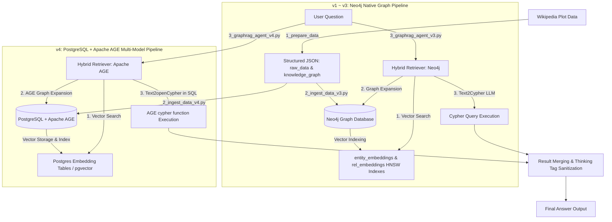

# PRD: GraphRAG Agent (Demon Slayer Season 1 Knowledge Graph) 🕸️

## 1. Document & Project Overview

- **Project Name:** `learn_graphrags_agent`
- **Target Domain:** Knowledge Graph Construction and Natural Language QA for Anime Plot Summaries (Demon Slayer Season 1)
- **Primary Goal:** Transform unstructured plot text into structured Knowledge Graphs across dual graph database backends (**Neo4j** & **Apache AGE on PostgreSQL**) and deliver high-precision Hybrid Retrieval (Vector Similarity + Graph Expansion + Text2Cypher / openCypher) for natural language questions.

---

## 2. Project Architecture & Technical Stack

### Technical Stack

| Component | Technology | Purpose |
| :--- | :--- | :--- |
| **Language & Runtime** | Python 3.12+ / `uv` | Strictly typed runtime execution |
| **Graph Database (Native)** | Neo4j 5+ (Docker Container) | Native Property Graph storage & Cypher query execution (v1 ~ v3) |
| **Graph Database (Relational Multi-Model)** | Apache AGE 1.5+ on PostgreSQL 16+ (Docker Container) | Multi-model Relational + Graph database with openCypher execution (v4) |
| **Database Drivers & ORM** | `neo4j` (Bolt) / `psycopg2-binary` / `asyncpg` | Database drivers for Neo4j Bolt protocol and PostgreSQL AGE connections |
| **LLM Provider** | Ollama (`sam860/exaone-4.0:1.2b-thinking-Q8_0`) / OpenAI API | Entity/Relationship extraction, Text2Cypher / openCypher, Answer synthesis |
| **Embedding Engine** | Ollama (`bge-m3:567m` - 1024 dim) / OpenAI | Node & Relationship vector embedding generation |
| **Orchestration** | LangChain / LangGraph / Neo4j-GraphRAG | Agent state graph & hybrid retrieval pipeline |
| **Web Scraping & E2E Test** | Playwright (Headless) & BeautifulSoup4 | Wikipedia scraping & headless UI/pipeline validation |
| **Web Service & Dashboard** | FastAPI & HTML5/CSS3 (Vanilla) | GraphRAG agent UI explorer & REST API |
| **Data Validation** | Pydantic v2 | JSON schema validation and entity sanitization |
| **Configuration** | `python-dotenv` & `config.py` | Centralized `.env` environment loading |

### High-Level Architecture



---

## 3. Current Project Analysis & Pipeline Specification (파이프라인 분석 및 사양)

### 3.1 Neo4j Pipeline Execution Analysis (v1 ~ v3)

1. **Step 1: Data Preparation (`src/v3/1_prepare_data_v3.py`)**
   - Scrapes Wikipedia Demon Slayer Season 1 episode summaries (episodes 1~26).
   - Calls LLM with structured Pydantic schemas (`Node`, `Relationship`, `GraphResponse`).
   - Normalizes canonical Korean names (e.g. `카마도 탄지로`, `토미오카 기유`, `키부츠지 무잔`).
   - Validates node labels (`인간`, `도깨비`) and 24 relationship types (`FIGHTS`, `PROTECTS`, `TRAINS`, etc.).
   - Outputs `output/raw_data_v3.json`, `output/knowledge_graph_v3.json`, and `output/statistics_v3.json`.

2. **Step 2: Data Ingestion (`src/v3/2_ingest_data_v3.py`)**
   - Clears existing Neo4j database to guarantee idempotency.
   - Generates 1024-dimensional embeddings for all nodes and relationships using `bge-m3:567m`.
   - Creates nodes with property `embedding` and relationships with property `embedding`.
   - Automatically builds HNSW vector indexes: `entity_embeddings_*` and `rel_embeddings_*`.

3. **Step 3: GraphRAG Agent (`src/v3/3_graphrag_agent_v3.py`)**
   - **Query Classifier**: Categorizes queries into `SINGLE_ENTITY`, `RELATIONSHIP`, `EPISODE_SPECIFIC`, or `GENERAL`.
   - **Vector Retriever**: Computes cosine similarity to pull seed nodes and relevant relationships.
   - **Graph Expander**: Performs 1~2 hop graph traversals from seed nodes.
   - **Clean LLM Parser**: Post-processes responses from thinking models by stripping `<think>...</think>` tags.
   - **Cypher Generator & Executor**: Generates safe, parameterized Cypher queries with retry loops and schema context.

---

### 3.2 Version 4 Pipeline: Apache AGE (PostgreSQL Multi-Model Graph) Pipeline

Apache AGE (A Graph Extension)는 PostgreSQL 상에서 구동되는 오픈소스 관계형-그래프 하이브리드 확장 프로그램입니다. v4는 기존의 RDBMS 데이터 인프라와 그래프 탐색 및 벡터 검색을 단일 엔진(PostgreSQL)에서 통합 처리하는 엔터프라이즈 멀티모델 아키텍처를 제공합니다.

1. **Step 1: Data Preparation (`src/v4/1_prepare_data_v4.py`)**
   - Pydantic v2 기반의 표준 데이터 파이프라인 재사용 (동일한 데이터 품질 및 정규화 보장).
   - Apache AGE 정점(Vertex) 라벨(`인간`, `도깨비`) 및 간선(Edge) 라벨(`FIGHTS`, `PROTECTS`, `TRAINS`, ...)과의 호환성 검증.
   - PostgreSQL 특화 이스케이프 및 JSON/agtype 직렬화 규격 준수.
   - 아티팩트 저장: `output/knowledge_graph_v4.json`, `output/raw_data_v4.json`.

2. **Step 2: Data Ingestion (`src/v4/2_ingest_data_v4.py`)**
   - **연결 및 확장 로드**: `psycopg2` 또는 `asyncpg`를 통해 `POSTGRES_HOST:POSTGRES_PORT`에 접속, `LOAD 'age';` 및 `SET search_path = ag_catalog, "$user", public;` 실행.
   - **그래프 생성 및 초기화**:
     ```sql
     SELECT drop_graph('demon_slayer', true); -- 멱등성 보장
     SELECT create_graph('demon_slayer');
     ```
   - **라벨 사전 등록**:
     - 정점 라벨: `SELECT create_vlabel('demon_slayer', '인간');`, `SELECT create_vlabel('demon_slayer', '도깨비');`
     - 간선 라벨: 24개 관계 유형에 대한 `create_elabel` 자동 등록.
   - **정점(Vertex) 생성**:
     ```sql
     SELECT * FROM cypher('demon_slayer', $$
         CREATE (:인간 {name: '카마도 탄지로', episode: 1, role: '주인공'})
     $$) as (v agtype);
     ```
   - **간선(Edge) 연결**:
     ```sql
     SELECT * FROM cypher('demon_slayer', $$
         MATCH (a:인간 {name: '카마도 탄지로'}), (b:도깨비 {name: '사비토'})
         CREATE (a)-[:TRAINS_WITH {action: '수련'} retaining]->(b)
     $$) as (e agtype);
     ```
   - **임베딩 테이블 적재**: PostgreSQL 내 `demon_slayer_node_embeddings` 및 `demon_slayer_edge_embeddings` 테이블을 생성하여 `bge-m3:567m` (1024차원) 벡터 데이터 적재 및 코사인 유사도 검색 인덱스 구성.

3. **Step 3: GraphRAG Agent (`src/v4/3_graphrag_agent_v4.py`)**
   - **Query Classifier**: 자연어 질문의 유형(단일 엔티티, 관계, 에피소드, 일반) 자동 판별.
   - **Vector Seed Retrieval**: PostgreSQL 임베딩 테이블에서 코사인 유사도 쿼리로 상위 Top-K 시드 정점 및 간선 추출.
   - **AGE Graph Expansion**: 시드 정점 기반으로 1~2 hop 서브그래프를 순회하는 AGE Cypher 쿼리 동적 실행:
     ```sql
     SELECT * FROM cypher('demon_slayer', $$
         MATCH (n {name: '카마도 탄지로'})-[r]-(m)
         RETURN n.name, type(r), m.name
     $$) as (source agtype, relationship agtype, target agtype);
     ```
   - **Text-to-openCypher Generator**:
     - PostgreSQL SQL 래핑(`SELECT * FROM cypher('graph_name', $$ ... $$) as (...)`) 구조를 반영한 시스템 프롬프트.
     - openCypher 표준 문법에 맞춘 쿼리 생성 및 `agtype` 반환 컬럼 매핑.
     - SQL-Graph 하이브리드 결합: 관계형 메타데이터(에피소드 정보, 통계)와 그래프 탐색 패턴을 단일 SQL 트랜잭션에서 결합.
   - **Clean LLM Response**: EXAONE 등 추론 모델의 `<think>...</think>` 태그 정제 및 최종 답변 합성.

---

## 4. Configuration & Environment Management (.env)

모든 애플리케이션 및 인프라 설정은 루트 `.env` 또는 `dockers/.env` 파일에서 중앙 집중식으로 관리되며 `config.py`를 통해 안전하게 주입됩니다.

### `.env` Variable Specification

```env
# Infrastructure & Containers
PROJECT_NAME=graphrag_agent
COMPOSE_PROFILES=neo4j,postgres,mongo,ollama,app

# Neo4j Database (v1 ~ v3)
NEO4J_URI=bolt://localhost:7687
NEO4J_USER=neo4j
NEO4J_PASSWORD=admin123
NEO4J_DATABASE=db-graphrag-agent

# PostgreSQL + Apache AGE (v4)
AGE_IMAGE_TAG=latest
POSTGRES_HOST=localhost
POSTGRES_PORT=5432
POSTGRES_USER=admin
POSTGRES_PASSWORD=admin123
POSTGRES_DB=db_graphrag_agent
AGE_GRAPH_NAME=demon_slayer

# MongoDB
MONGO_HOST=localhost
MONGO_PORT=27017
MONGO_USER=admin
MONGO_PASSWORD=admin123
MONGO_DB=db_graphrag_agent

# LLM & Embedding Server
LLM_MODEL=sam860/exaone-4.0:1.2b-thinking-Q8_0
EMBEDDING_MODEL=bge-m3:567m
MODEL_API_URL=http://localhost:11434/v1
OPENAI_API_KEY=ollama
AI_OLAMA_CPU=8

# Hybrid Retrieval Settings
USE_HYBRID_RETRIEVAL=true
VECTOR_TOP_K=5
GRAPH_EXPANSION_DEPTH=2

# Vector Indexes & Schema
VECTOR_INDEX_NODE=entity_embeddings
VECTOR_INDEX_RELATIONSHIP_PREFIX=rel_embeddings
EMBEDDING_DIMENSION=1024
NODE_LABELS=인간,도깨비
RELATIONSHIP_TYPES=FIGHTS,PROTECTS,TRAINS,TRAINS_WITH,KNOWS,FAMILY_OF,SIBLING_OF,ALLY_OF,ENEMY_OF,DEFEATS,SAVES,RESCUES,MEETS,ENCOUNTERS,GUIDES,ATTACKS,DEFENDS,TRANSFORMS,JOINS,SUPPORTS,REUNITES_WITH,BATTLES,HEALS,TEACHES
```

---

## 5. Version-Based Directory Structure & Comparison

### Directory Structure

```text
/apps/learn_graphrags_agent
├── .env                              # Root Environment Variables
├── config.py                         # Centralized Config Loader
├── README.md                         # Project Readme & Instructions
├── dockers/                          # Docker Services Setup
│   ├── .env
│   ├── docker-compose.yml
│   ├── Dockerfile.ollama
│   ├── Dockerfile.fullstack
│   └── postgres/
│       └── init/
│           └── 01_init_age.sql       # Apache AGE Extension Auto-loader
├── output/                           # Output Data Artifacts
├── docs/                             # Documentation
│   ├── PRD.md                        # Master PRD Specification
│   └── agent/
│       ├── harness_prompt.md         # Agent Harness Prompt Specification
│       └── system_prompt.md          # Agent System Prompt Specification
└── src/                              # Source Code by Version
    ├── v1/                           # Baseline Version (Basic Text2Cypher - Neo4j)
    │   ├── 1_prepare_data_v1.py
    │   ├── 2_ingest_data_v1.py
    │   └── 3_graphrag_agent_v1.py
    ├── v2/                           # Intermediate Version (Metadata Filtered Vector RAG - Neo4j)
    │   ├── 1_prepare_data_v2.py
    │   ├── 2_ingest_data_v2.py
    │   └── 3_graphrag_agent_v2.py
    ├── v3/                           # Production Hybrid Version (Vector + Graph Expansion - Neo4j)
    │   ├── 1_prepare_data_v3.py
    │   ├── 2_ingest_data_v3.py
    │   └── 3_graphrag_agent_v3.py
    ├── v4/                           # Multi-Model Hybrid Version (PostgreSQL + Apache AGE)
    │   ├── 1_prepare_data_v4.py
    │   ├── 2_ingest_data_v4.py
    │   └── 3_graphrag_agent_v4.py
    ├── app/                          # FastAPI Web Service & Explorer
    │   ├── __init__.py
    │   └── main.py
    └── utils/                        # Utilities & Validation
        ├── check_indexes.py
        ├── playwright_scraper.py
        └── test_pipeline_playwright.py
```

### Version Comparison Matrix

| 항목 | v1 (Baseline) | v2 (Metadata Filter) | v3 (Neo4j Hybrid) | v4 (Apache AGE) |
| :--- | :--- | :--- | :--- | :--- |
| **백엔드 DB** | Neo4j 5 | Neo4j 5 | Neo4j 5 | PostgreSQL 16+ & Apache AGE |
| **그래프 모델** | Native Property Graph | Native Property Graph | Native Property Graph | Relational Property Graph (`ag_catalog`) |
| **쿼리 언어** | Neo4j Cypher | Neo4j Cypher | Neo4j Cypher | openCypher in SQL (`cypher(...)`) |
| **벡터 검색** | 미지원 (순수 Cypher) | 벡터 검색 + 메타데이터 필터링 | HNSW 노드/관계 벡터 인덱스 | PostgreSQL 벡터 테이블 / Cosine 검색 |
| **그래프 확장** | 0 hop (단일 매칭) | 1 hop 정적 확장 | 1~2 hop 동적 하이브리드 확장 | 1~2 hop AGE 하이브리드 순회 |
| **RDBMS 결합** | 불가 (그래프 전용) | 불가 (그래프 전용) | 불가 (그래프 전용) | **가능** (SQL JOIN + Cypher 동시 질의) |
| **적용 시나리오** | 기초 LLM-Cypher 검증 | 속성 기반 필터링 질의 | 고성능 전용 그래프 RAG | 엔터프라이즈 RDBMS 통합형 RAG |

---

## 6. Execution & Verification Guide

### 1. Environment & Docker Startup

```bash
cd dockers

# 전체 서비스 실행 (Neo4j, Postgres AGE, Mongo, Ollama, App)
docker-compose up -d

# 또는 백엔드별 선별 실행:
# [Neo4j v1~v3 실행 시]
docker-compose --profile neo4j --profile ollama up -d

# [Apache AGE v4 실행 시]
docker-compose --profile postgres --profile ollama up -d

cd ..
```

### 2. Version 3 (Neo4j Hybrid) Execution

```bash
# Step 1: 데이터 수집 및 정규화
uv run src/v3/1_prepare_data_v3.py

# Step 2: Neo4j 그래프 적재 및 HNSW 벡터 인덱스 생성
uv run src/v3/2_ingest_data_v3.py

# Step 3: GraphRAG 에이전트 CLI 실행
uv run src/v3/3_graphrag_agent_v3.py

# 유틸리티: Neo4j 벡터 인덱스 상태 점검
uv run src/utils/check_indexes.py
```

### 3. Version 4 (Apache AGE) Execution

```bash
# Step 1: 데이터 수집 및 AGE 호환 포맷 정규화
uv run src/v4/1_prepare_data_v4.py

# Step 2: PostgreSQL AGE 그래프 생성, 노드/간선 적재 및 임베딩 인덱싱
uv run src/v4/2_ingest_data_v4.py

# Step 3: Apache AGE 기반 GraphRAG 에이전트 CLI 실행
uv run src/v4/3_graphrag_agent_v4.py
```

### 4. Apache AGE Direct SQL Verification (psql 검증)

```bash
# PostgreSQL 컨테이너 접속 후 AGE 그래프 쿼리 테스트
docker exec -it graphrag_agent_db_postgres psql -U admin -d db_graphrag_agent -c "
LOAD 'age';
SET search_path = ag_catalog, '$user', public;

-- 1. 생성된 노드(인간/도깨비) 개수 확인
SELECT * FROM cypher('demon_slayer', \$\$
    MATCH (n) RETURN labels(n), count(n)
\$\$) as (label agtype, count agtype);

-- 2. 카마도 탄지로 중심 관계 1-hop 조회
SELECT * FROM cypher('demon_slayer', \$\$
    MATCH (a:인간 {name: '카마도 탄지로'})-[r]->(b)
    RETURN a.name, type(r), b.name
\$\$) as (source agtype, rel agtype, target agtype);
"
```

---

## 7. Technical Deep-Dive: Neo4j vs. Apache AGE

### 7.1 Apache AGE의 핵심 원리 및 openCypher 구문 래핑

1. **SQL 내 openCypher 호출 구조**:
   Apache AGE는 PostgreSQL의 함수형 테이블 인터페이스를 통해 Cypher 쿼리를 실행합니다:
   ```sql
   SELECT [반환 컬럼 목록]
   FROM cypher('그래프_이름', $$
       MATCH (s:정점_라벨)-[r:간선_라벨]->(t:정점_라벨)
       WHERE s.name = '카마도 탄지로'
       RETURN s.name, type(r), t.name
   $$) AS (출력컬럼1 agtype, 출력컬럼2 agtype, ...);
   ```

2. **데이터 타입 변환 (`agtype`)**:
   - AGE의 모든 그래프 결과는 JSONB 상위 호환 타입인 `agtype`으로 반환됩니다.
   - 숫자, 문자열, 맵(딕셔너리), 배열을 포함하며 Python 드라이버(`psycopg2` / `asyncpg`) 파싱 시 Python 기본 자료형으로 디코딩됩니다.

3. **엔터프라이즈 멀티모델(Multi-Model) 결합의 강점**:
   - 기존 RDBMS(PostgreSQL)의 트랜잭션(ACID) 및 관계형 테이블과 그래프 데이터를 단일 DB 인스턴스에서 통합 관리할 수 있습니다.
   - 별도의 전용 그래프 데이터베이스를 도입/운영하는 인프라 오버헤드를 절감할 수 있습니다.
   - SQL의 강력한 집계, 윈도우 함수 및 조인(JOIN)과 openCypher의 유연한 패턴 매칭을 하나의 쿼리 파이프라인으로 융합할 수 있습니다.

