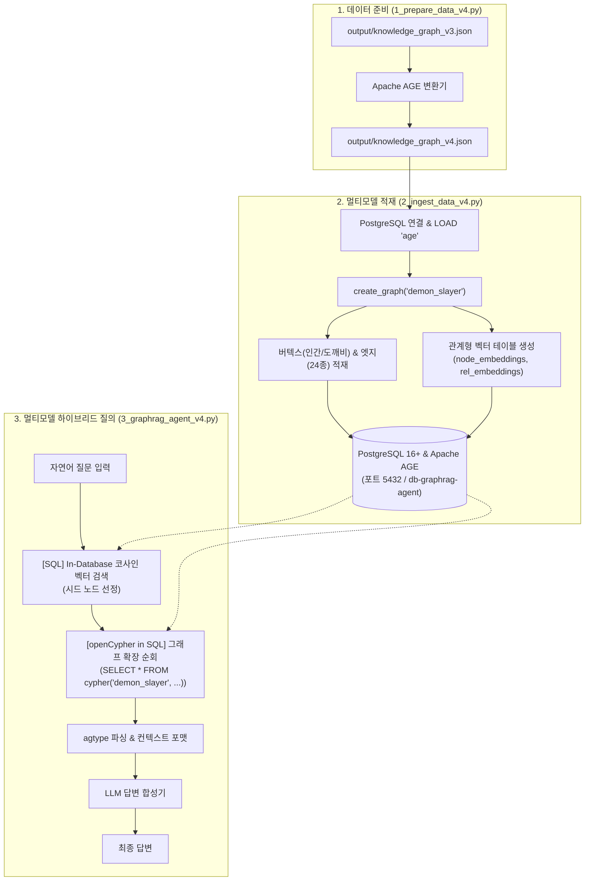

# Apache AGE Multi-Model v4 — PostgreSQL 16+ & Apache AGE 멀티모델 RAG

본 모듈은 **PostgreSQL 16+** RDBMS 인프라 위에서 **Apache AGE 1.5+ 확장 그래프 엔진**과 **In-Database 관계형 벡터 테이블**을 유기적으로 결합한 엔터프라이즈 Multi-Model GraphRAG 파이프라인입니다.  
별도의 전용 그래프 DB 없이 엔터프라이즈 RDBMS의 ACID 트랜잭션, 관계형 데이터(SQL JOIN), 그리고 openCypher 그래프 순회를 동시에 수행합니다.

---

## 🏗️ 실행 다이어그램 (Execution Diagram)

### 1. 텍스트 다이어그램 (ASCII Flow)

```text
[1. 데이터 준비: 1_prepare_data_v4.py]
  Pydantic v2 정규화 데이터 (output/knowledge_graph_v3.json)
       │
       ▼
  Apache AGE 규격 변환 (Graph: demon_slayer, Vertex: 인간/도깨비, Edge: 24종)
       │
       ▼
  output/knowledge_graph_v4.json (AGE 전용 지식그래프 아티팩트)

[2. 멀티모델 데이터 적재: 2_ingest_data_v4.py]
  output/knowledge_graph_v4.json
       │
       ▼ (psycopg2를 통한 PostgreSQL 접속)
  [AGE 확장 로드 & 초기화]
       ├─ LOAD 'age';
       ├─ SET search_path = ag_catalog, "$user", public;
       └─ SELECT drop_graph('demon_slayer', true); SELECT create_graph('demon_slayer');
       │
       ▼
  [그래프 버텍스 & 엣지 적재]
       ├─ openCypher 버텍스 생성 (CREATE (:인간 {id: ..., name: ...}))
       └─ openCypher 엣지 생성 (CREATE (a)-[:관계명 {episode: ...}]->(b))
       │
       ▼
  [관계형 벡터 테이블 생성 & 저장]
       ├─ CREATE TABLE node_embeddings (node_id, node_name, label, embedding float8[])
       └─ CREATE TABLE relationship_embeddings (rel_type, embedding float8[])

[3. 하이브리드 에이전트 실행: 3_graphrag_agent_v4.py]
  자연어 사용자 질문 ("십이귀월 루이와 싸운 인물과 사건 배경은?")
       │
       ▼
  [Step 3.1] In-Database SQL 코사인 유사도 벡터 검색
       └─ SELECT node_id, node_name FROM node_embeddings ORDER BY cosine_similarity(...)
       │
       ▼
  [Step 3.2] openCypher in SQL 그래프 1~2 Hop 순회
       └─ SELECT * FROM cypher('demon_slayer', $$
            MATCH (a:인간)-[r]->(b:도깨비 {name: '루이'})
            RETURN a.name, type(r), b.name, r.context
          $$) as (검사 agtype, 관계 agtype, 적 agtype, 정황 agtype);
       │
       ▼
  [Step 3.3] SQL-openCypher 하이브리드 결합 & agtype 디코딩
       │
       ▼
  [Step 3.4] LLM 답변 합성 (생각태그 제거 및 한국어 개조식 답변)
```

### 2. Mermaid 다이어그램



---

## 📋 실행 파일 순서 및 명세

| 실행 순서 | 파일명 | 역할 및 설명 | 주요 참조 모듈 / 라이브러리 | 입력 (Input) | 출력 (Output) | 실행 명령어 |
| :---: | :--- | :--- | :--- | :--- | :--- | :--- |
| **Step 1** | [1_prepare_data_v4.py](file:///apps/learn_graphrags_agent/src/apache_age_v4/1_prepare_data_v4.py) | Apache AGE 규격에 맞춘 그래프 모델 데이터 변환 및 검증 | `json`, `pydantic`, `config.py` | `output/knowledge_graph_v3.json` | `output/knowledge_graph_v4.json` | `python3 src/apache_age_v4/1_prepare_data_v4.py` |
| **Step 2** | [2_ingest_data_v4.py](file:///apps/learn_graphrags_agent/src/apache_age_v4/2_ingest_data_v4.py) | PostgreSQL `demon_slayer` 그래프 버텍스/엣지 적재 및 관계형 벡터 테이블 생성 | `psycopg2`, `openai`, `config.py` | `output/knowledge_graph_v4.json` | PostgreSQL AGE 지식그래프 + 벡터 테이블 | `python3 src/apache_age_v4/2_ingest_data_v4.py` |
| **Step 3** | [3_graphrag_agent_v4.py](file:///apps/learn_graphrags_agent/src/apache_age_v4/3_graphrag_agent_v4.py) | In-DB 벡터 검색 + openCypher in SQL 하이브리드 질의 실행 CLI | `psycopg2`, `openai`, `config.py` | 터미널 자연어 질문 | openCypher+SQL 결합 최종 답변 | `python3 src/apache_age_v4/3_graphrag_agent_v4.py` |

---

## 🔍 적재된 데이터 확인 예제 (psql & Direct SQL)

### 1. PostgreSQL CLI (psql) 접속
도커 컨테이너 내부 psql로 접속합니다:

```bash
docker exec -it dockers-postgres_age-1 psql -U postgres -d db-graphrag-agent
```

### 2. 세션 필수 초기화 명령어
Apache AGE 기능을 사용하기 위해 질의 전 세션에서 반드시 실행해야 합니다:

```sql
LOAD 'age';
SET search_path = ag_catalog, "$user", public;
```

### 3. 검증용 핵심 openCypher in SQL 쿼리

```sql
-- 1. 전체 버텍스(인간/도깨비) 라벨별 개수 조회
SELECT * FROM cypher('demon_slayer', $$
    MATCH (n)
    RETURN label(n), count(n)
$$) as (label agtype, count agtype);

-- 2. 주요 등장인물 및 연결된 엣지 상위 10개 조회
SELECT * FROM cypher('demon_slayer', $$
    MATCH (a:인간)-[r]->(b)
    RETURN a.name, type(r), b.name
    LIMIT 10
$$) as (출발 agtype, 관계 agtype, 도착 agtype);

-- 3. 관계형 벡터 테이블(node_embeddings) 행 수 및 스키마 확인
SELECT node_id, node_name, label, array_length(embedding, 1) as vector_dim
FROM node_embeddings
LIMIT 5;

-- 4. 특정 도깨비('루이')와 관련된 전투 사건 openCypher 조회
SELECT * FROM cypher('demon_slayer', $$
    MATCH (a)-[r]->(b:도깨비 {name: '루이'})
    RETURN a.name, type(r), b.name, r.episode
$$) as (인물 agtype, 관계 agtype, 대상 agtype, 에피소드 agtype);
```

### 4. MCP 도구를 통한 확인
Model Context Protocol(MCP) 도구로 터미널에서 상태를 즉시 점검할 수 있습니다:

```bash
python3 src/utils/mcp_db_server.py --test
```
