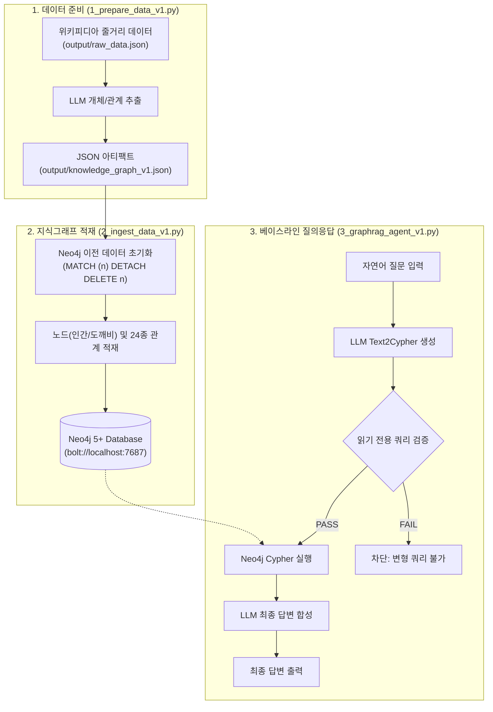

# Baseline v1 — Text2Cypher 베이스라인 파이프라인

본 모듈은 Neo4j 5+ 기반의 가장 기본적인 자연어-Cypher 변환(**Text2Cypher**) GraphRAG 파이프라인을 제공합니다.  
벡터 검색 없이 거대 언어 모델(LLM)이 사용자 질의를 순수 Cypher 쿼리로 변환하고, Neo4j 그래프에서 단일 매칭(0-hop 또는 기본 1-hop)을 수행하여 답변을 도출하는 벤치마크 기준 버전입니다.

---

## 🏗️ 실행 다이어그램 (Execution Diagram)

### 1. 텍스트 다이어그램 (ASCII Flow)

```text
[1. 데이터 준비: 1_prepare_data_v1.py]
  위키피디아 줄거리 (output/raw_data.json 또는 웹 스크래핑)
       │
       ▼
  LLM 엔티티/관계 추출 (OpenAI/Ollama 호환)
       │
       ▼
  output/knowledge_graph_v1.json (노드 19개 / 관계 310개)

[2. 그래프 적재: 2_ingest_data_v1.py]
  output/knowledge_graph_v1.json
       │
       ▼ (멱등성 보장: 기존 데이터 초기화)
  Neo4j Bolt 연결 (bolt://localhost:7687)
       │
       ▼
  노드(:인간, :도깨비) 및 관계 생성 (CREATE/MERGE)

[3. 질의응답 실행: 3_graphrag_agent_v1.py]
  자연어 사용자 질문 ("카마도 탄지로와 관련된 인물은?")
       │
       ▼
  LLM Text2Cypher 생성 프롬프트
       │
       ▼
  생성된 Cypher 쿼리 (MATCH (p:인간 {name: '카마도 탄지로'})-[r]->(t) RETURN ...)
       │
       ▼ (읽기 전용 가드레일 통과)
  Neo4j 쿼리 실행 및 레코드 수집
       │
       ▼
  LLM 답변 합성 (생각태그 <think> 제거)
       │
       ▼
  최종 한국어 개조식 답변 출력
```

### 2. Mermaid 다이어그램



---

## 📋 실행 파일 순서 및 명세

| 실행 순서 | 파일명 | 역할 및 설명 | 주요 참조 모듈 / 라이브러리 | 입력 (Input) | 출력 (Output) | 실행 명령어 |
| :---: | :--- | :--- | :--- | :--- | :--- | :--- |
| **Step 1** | [1_prepare_data_v1.py](file:///apps/learn_graphrags_agent/src/baseline_v1/1_prepare_data_v1.py) | 위키피디아 줄거리 데이터로부터 기본 엔티티(`인간`, `도깨비`)와 관계 추출 | `openai`, `pydantic`, `bs4`, `config.py` | `output/raw_data.json` 또는 웹 URL | `output/knowledge_graph_v1.json` | `python3 src/baseline_v1/1_prepare_data_v1.py` |
| **Step 2** | [2_ingest_data_v1.py](file:///apps/learn_graphrags_agent/src/baseline_v1/2_ingest_data_v1.py) | 추출된 JSON 데이터를 읽어 Neo4j 데이터베이스에 멱등 적재 | `neo4j.GraphDatabase`, `config.py` | `output/knowledge_graph_v1.json` | Neo4j 노드 및 관계 생성 | `python3 src/baseline_v1/2_ingest_data_v1.py` |
| **Step 3** | [3_graphrag_agent_v1.py](file:///apps/learn_graphrags_agent/src/baseline_v1/3_graphrag_agent_v1.py) | 자연어 입력을 받아 Text2Cypher 생성 후 Neo4j 질의 및 답변 도출 CLI | `neo4j`, `openai`, `config.py` | 터미널 자연어 질문 | 콘솔 개조식 한국어 답변 | `python3 src/baseline_v1/3_graphrag_agent_v1.py` |

---

## 🔍 적재된 데이터 확인 예제 (Neo4j)

### 1. 웹 브라우저 UI에서 확인
- **URL**: [http://localhost:7474](http://localhost:7474)
- **인증 정보**:
  - Bolt URL: `bolt://localhost:7687`
  - 계정: `neo4j` / 비밀번호: `admin123` (또는 `.env` 설정값)

### 2. cypher-shell 터미널 접속 및 조회
도커 컨테이너 내부 `cypher-shell`로 직접 질의합니다:

```bash
docker exec -it dockers-neo4j-1 cypher-shell -u neo4j -p admin123 -d db-graphrag-agent
```

### 3. 검증용 핵심 Cypher 쿼리

```cypher
// 1. 전체 노드 라벨별 개수 집계
MATCH (n)
RETURN labels(n) AS Label, count(n) AS Count;

// 2. 전체 관계 타입별 개수 집계 (상위 10개)
MATCH ()-[r]->()
RETURN type(r) AS RelationType, count(r) AS Count
ORDER BY Count DESC
LIMIT 10;

// 3. 특정 캐릭터('카마도 탄지로')의 모든 관계 조회
MATCH (a:인간 {name: '카마도 탄지로'})-[r]->(b)
RETURN a.name AS 출발, type(r) AS 관계, b.name AS 도착
LIMIT 10;

// 4. 도깨비 캐릭터 목록 및 혈귀술 속성 조회
MATCH (d:도깨비)
RETURN d.name AS 이름, d.blood_art AS 혈귀술, d.rank AS 계급;
```
