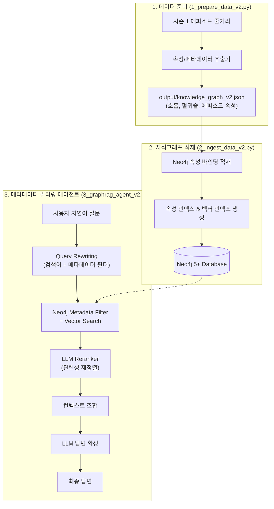

# Metadata Filter v2 — 메타데이터 필터링 및 Reranking 파이프라인

본 모듈은 단순 텍스트 질의의 한계를 극복하기 위해 **질의 재작성(Query Rewriting)**, **메타데이터 속성 필터링(Metadata Filtering)**, **벡터 검색**, **LLM 리랭킹(Reranking)**을 결합한 2단계 GraphRAG 파이프라인입니다.

---

## 🏗️ 실행 다이어그램 (Execution Diagram)

### 1. 텍스트 다이어그램 (ASCII Flow)

```text
[1. 데이터 준비: 1_prepare_data_v2.py]
  위키피디아 줄거리 데이터 (시즌 1 전 에피소드)
       │
       ▼
  엔티티 + 메타데이터 속성 정밀 추출 (에피소드, 소속, 호흡, 혈귀술 등)
       │
       ▼
  output/knowledge_graph_v2.json (메타데이터 속성 포함 지식그래프)

[2. 그래프 & 인덱스 적재: 2_ingest_data_v2.py]
  output/knowledge_graph_v2.json
       │
       ▼ (기존 그래프 초기화 및 멱등 적재)
  노드/관계 속성 적재 + 메타데이터 인덱스(episode, breathing, rank) 생성
       │
       ▼
  Neo4j 5+ (db-graphrag-agent)

[3. 에이전트 검색 및 답변: 3_graphrag_agent_v2.py]
  사용자 질문 ("19화에서 탄지로가 사용한 기술과 관련된 사건은?")
       │
       ▼
  [Step 3.1] Query Rewriting (LLM)
       ├─ 벡터 최적화 검색어 생성
       └─ 메타데이터 필터 추출 (예: episode=19, entity='카마도 탄지로')
       │
       ▼
  [Step 3.2] Metadata-aware Vector Search (Neo4j)
       ├─ 메타데이터 일치 후보 1차 필터링
       └─ 벡터 유사도 점수 결합 Top-K 추출
       │
       ▼
  [Step 3.3] Reranking (LLM 점수화)
       └─ 질문 관련성 기준 상위 정밀 재정렬
       │
       ▼
  [Step 3.4] 최종 답변 합성 (LLM)
       └─ 생각 태그 정제 및 구조화된 결과 출력
```

### 2. Mermaid 다이어그램



---

## 📋 실행 파일 순서 및 명세

| 실행 순서 | 파일명 | 역할 및 설명 | 주요 참조 모듈 / 라이브러리 | 입력 (Input) | 출력 (Output) | 실행 명령어 |
| :---: | :--- | :--- | :--- | :--- | :--- | :--- |
| **Step 1** | [1_prepare_data_v2.py](file:///apps/learn_graphrags_agent/src/metadata_filter_v2/1_prepare_data_v2.py) | 줄거리 데이터에서 에피소드, 호흡, 혈귀술 등 메타데이터 속성이 포함된 개체/관계 추출 | `openai`, `pydantic`, `config.py` | `output/raw_data.json` | `output/knowledge_graph_v2.json` | `python3 src/metadata_filter_v2/1_prepare_data_v2.py` |
| **Step 2** | [2_ingest_data_v2.py](file:///apps/learn_graphrags_agent/src/metadata_filter_v2/2_ingest_data_v2.py) | Neo4j에 노드/관계 및 상세 속성을 적재하고 메타데이터 인덱스 구축 | `neo4j`, `config.py`, `tqdm` | `output/knowledge_graph_v2.json` | 속성 인덱싱된 Neo4j 그래프 | `python3 src/metadata_filter_v2/2_ingest_data_v2.py` |
| **Step 3** | [3_graphrag_agent_v2.py](file:///apps/learn_graphrags_agent/src/metadata_filter_v2/3_graphrag_agent_v2.py) | Query Rewrite ➔ 메타데이터 필터링 ➔ 벡터 검색 ➔ LLM Reranking 파이프라인 CLI | `neo4j`, `openai`, `config.py` | 터미널 자연어 질문 | 재정렬된 근거 기반 최종 답변 | `python3 src/metadata_filter_v2/3_graphrag_agent_v2.py` |

---

## 🔍 적재된 데이터 확인 예제 (Neo4j)

### 1. 메타데이터 속성 필터링 Cypher 쿼리

Neo4j Browser([http://localhost:7474](http://localhost:7474)) 또는 `cypher-shell`에서 실행합니다:

```cypher
// 1. 호흡(Breathing) 속성이 등록된 인간 캐릭터 조회
MATCH (p:인간)
WHERE p.breathing IS NOT NULL
RETURN p.name AS 이름, p.breathing AS 호흡, p.rank AS 계급;

// 2. 십이귀월 계급(Rank) 및 혈귀술 속성이 있는 도깨비 조회
MATCH (d:도깨비)
WHERE d.rank IS NOT NULL OR d.blood_art IS NOT NULL
RETURN d.name AS 이름, d.rank AS 계급, d.blood_art AS 혈귀술;

// 3. 특정 에피소드(제19화)에 발생한 사건/관계 필터링
MATCH (a)-[r]->(b)
WHERE r.episode = 19
RETURN a.name AS 출발인물, type(r) AS 관계, b.name AS 대상인물, r.context AS 상황설명
LIMIT 5;

// 4. 에피소드 번호별 관계 수 집계 통계
MATCH ()-[r]->()
WHERE r.episode IS NOT NULL
RETURN r.episode AS 에피소드, count(r) AS 발생관계수
ORDER BY r.episode;
```
