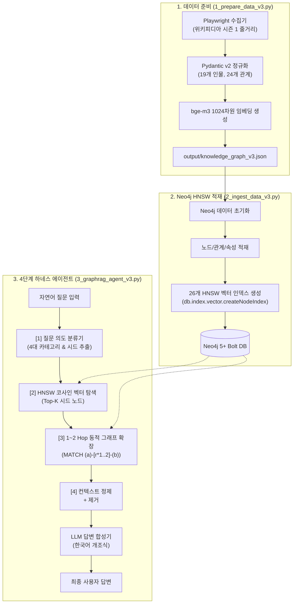

# Neo4j Production Hybrid v3 — 벡터 + 1~2 Hop 그래프 확장 하이브리드 RAG

본 모듈은 **1024차원 `bge-m3` HNSW 벡터 인덱스**와 **1~2 Hop 동적 그래프 순회(Dynamic Graph Expansion)**, 그리고 **Neo4j 네이티브 Cypher**를 유기적으로 융합한 엔터프라이즈급 Production 하이브리드 GraphRAG 파이프라인입니다.

---

## 🏗️ 실행 다이어그램 (Execution Diagram)

### 1. 텍스트 다이어그램 (ASCII Flow)

```text
[1. 데이터 준비: 1_prepare_data_v3.py]
  Playwright Headless 웹 스크래퍼 (또는 output/raw_data.json)
       │
       ▼
  Pydantic v2 스키마 정규화 (19개 정규화 엔티티, 24개 표준 관계)
       │
       ▼
  1024차원 bge-m3 임베딩 생성 & 로컬 캐싱
       │
       ▼
  output/knowledge_graph_v3.json (노드 19개 / 관계 310개 / 임베딩 벡터 완비)

[2. 그래프 및 HNSW 벡터 인덱스 적재: 2_ingest_data_v3.py]
  output/knowledge_graph_v3.json
       │
       ▼ (멱등성 보장: 기존 그래프 초기화)
  Neo4j 노드(:인간, :도깨비) 및 관계 적재
       │
       ▼
  HNSW 코사인 유사도 벡터 인덱스 구축 (26개 인덱스: entity_embeddings_*, rel_embeddings_*)
       │
       ▼
  Neo4j 5+ Database (bolt://localhost:7687)

[3. 4단계 하네스 에이전트 실행: 3_graphrag_agent_v3.py]
  자연어 사용자 질문 ("카마도 탄지로와 토미오카 기유의 관계 및 에피소드 활약은?")
       │
       ▼
  [Stage 1] 질문 의도 분류기 (Query Intent Classifier)
       └─ 4대 질문 유형(인물 개요, 관계, 전투/사건, 통계) 판별 및 엔티티 추출
       │
       ▼
  [Stage 2] 시드 노드 벡터 탐색 (HNSW Cosine Vector Search)
       └─ 질문 텍스트 ➔ 1024차원 임베딩 ➔ 유사도 기준 Top-K 시드 노드 선정
       │
       ▼
  [Stage 3] 1~2 Hop 동적 그래프 순회 (Dynamic BFS Expansion)
       └─ 시드 노드로부터 1~2 Hop 서브그래프 Cypher 확장 (`-[r*1..2]-`)
       │
       ▼ (읽기 전용 가드레일: MATCH/OPTIONAL MATCH만 허용)
  [Stage 4] 컨텍스트 포맷터 & 답변 합성기 (Answer Synthesizer)
       ├─ JSON 아티팩트 정제 및 문맥 구조화
       ├─ <think>...</think> 추론 태그 정규식 제거
       └─ 최종 한국어 개조식 답변 출력
```

### 2. Mermaid 다이어그램



---

## 📋 실행 파일 순서 및 명세

| 실행 순서 | 파일명 | 역할 및 설명 | 주요 참조 모듈 / 라이브러리 | 입력 (Input) | 출력 (Output) | 실행 명령어 |
| :---: | :--- | :--- | :--- | :--- | :--- | :--- |
| **Step 1** | [1_prepare_data_v3.py](file:///apps/learn_graphrags_agent/src/neo4j_hybrid_v3/1_prepare_data_v3.py) | 위키피디아 스크래핑 정규화, 19개 인물/도깨비 및 24개 표준 관계 검증, 1024차원 임베딩 생성 | `pydantic`, `openai`, `config.py`, `playwright_scraper` | `output/raw_data.json` 또는 온라인 위키 | `output/knowledge_graph_v3.json` | `python3 src/neo4j_hybrid_v3/1_prepare_data_v3.py` |
| **Step 2** | [2_ingest_data_v3.py](file:///apps/learn_graphrags_agent/src/neo4j_hybrid_v3/2_ingest_data_v3.py) | Neo4j 5+에 노드/관계 멱등 적재 및 26개 HNSW 코사인 벡터 인덱스 자동 구축 | `neo4j.GraphDatabase`, `config.py` | `output/knowledge_graph_v3.json` | HNSW 인덱싱된 Neo4j 지식그래프 | `python3 src/neo4j_hybrid_v3/2_ingest_data_v3.py` |
| **Step 3** | [3_graphrag_agent_v3.py](file:///apps/learn_graphrags_agent/src/neo4j_hybrid_v3/3_graphrag_agent_v3.py) | 4단계 하네스(의도분류 ➔ 시드벡터 ➔ 1~2hop 확장 ➔ 개조식 합성) Production CLI | `neo4j`, `openai`, `config.py`, `pydantic` | 터미널 자연어 질문 | 근거 기반 고품질 개조식 답변 | `python3 src/neo4j_hybrid_v3/3_graphrag_agent_v3.py` |

---

## 🔍 적재된 데이터 확인 예제 (Neo4j)

### 1. HNSW 벡터 인덱스 상태 점검 스크립트
전용 유틸리티로 26개 HNSW 인덱스 상태를 즉시 점검합니다:

```bash
python3 src/utils/check_indexes.py
```

### 2. Neo4j Browser 및 Cypher 검증 쿼리

Neo4j Browser([http://localhost:7474](http://localhost:7474))에서 아래 Cypher를 실행합니다:

```cypher
// 1. 등록된 모든 벡터 인덱스 목록 및 상태 확인
SHOW VECTOR INDEXES;

// 2. 1~2 Hop 동적 그래프 확장 조회 (카마도 탄지로 중심)
MATCH (a:인간 {name: '카마도 탄지로'})-[r*1..2]-(b)
RETURN a, r, b
LIMIT 25;

// 3. 인간 vs 도깨비 대결/전투 관계 조회
MATCH (a:인간)-[r:대결|전투|처치]->(b:도깨비)
RETURN a.name AS 검사, type(r) AS 관계, b.name AS 도깨비, r.episode AS 에피소드, r.context AS 정황
ORDER BY r.episode;

// 4. 특정 노드의 1024차원 임베딩 속성 탑재 확인
MATCH (n:인간 {name: '토미오카 기유'})
RETURN n.name, size(n.embedding) AS 임베딩차원, n.breathing AS 호흡;
```
